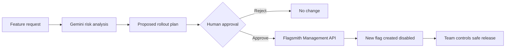

<div align="center">


# FlagPilot

### Move fast. Release carefully.

**An AI release agent that turns a rough feature request into a risk-aware, human-approved Flagsmith rollout.**

[](https://flagpilot-yw7w.onrender.com/)
[](https://github.com/shahkavya23/flagpilot)
[](https://www.flagsmith.com/)

**Toggle Wars 2026 · Track 02 — AI Agents and Feature Flags**

</div>

---

## Try it in 60 seconds

1. Open the **[live FlagPilot app](https://flagpilot-yw7w.onrender.com/)**.
2. Pick an example or describe a feature, such as `Add fingerprint login to a banking app`.
3. Enter a measurable success signal, such as `User logs in successfully without a password`.
4. Select **Generate safe rollout**.
5. Review the AI-created flag name, risk, rollout, safety rule and reasoning.
6. Select **Approve and create flag**. Only now does FlagPilot create the flag in Flagsmith.

> The free Render service may take around 50 seconds to wake up on the first visit.

### Live feature-flag trick

The presentation section is itself controlled by the Flagsmith flag `live_demo_button`.
Turn the flag **off** in Flagsmith and the section disappears from the live website; turn it **on** and it returns—without rebuilding or redeploying the app.

---

## Why FlagPilot?

Releasing a feature is not just an engineering task. A team must decide:

- How risky is this change?
- What percentage of users should receive it first?
- What result proves that it works?
- When should the rollout stop?
- Who is allowed to approve the final action?

Teams often make these decisions manually and inconsistently. FlagPilot converts a plain-English request into a clear rollout proposal, while keeping the irreversible action behind human approval.

| Without FlagPilot | With FlagPilot |
|---|---|
| Manually choose a flag name | AI proposes a consistent flag name |
| Guess a rollout percentage | Risk determines a cautious rollout |
| Forget the rollback condition | Every plan contains a safety rule |
| Create flags before review | Nothing changes before approval |
| Switch between several tools | Plan and create from one interface |

---

## How it works



FlagPilot deliberately separates **thinking** from **acting**:

1. **Plan** — Gemini examines the feature and its success metric.
2. **Explain** — The app returns a structured risk level, rollout, safety rule and reasoning.
3. **Approve** — A human reviews the complete proposal.
4. **Create** — The server calls the Flagsmith Management API only after approval.
5. **Release safely** — The new flag starts disabled, leaving the final rollout under team control.

<details>
<summary><strong>Example output: banking fingerprint login</strong></summary>

| Field | Example |
|---|---|
| Proposed flag | `fingerprint_login_enabled` |
| Risk | High |
| Initial rollout | 1% |
| Success metric | User logs in successfully without a password |
| Safety rule | Roll back if authentication failures exceed the safe limit |
| Why | Banking authentication has security and device-compatibility risks |

</details>

---

## Why Flagsmith is core to the project

Flagsmith is not decoration in FlagPilot—it performs the real release work.

- The **React SDK** reads `ai_release_planner` to control access to the planning experience.
- The **Management API** lets the approved AI agent create an actual feature flag.
- Every generated flag is created **disabled by default** for safety.
- `live_demo_button` proves that interface features can appear or disappear remotely without a redeploy.
- Real-time refresh keeps the presentation demo synchronized with Flagsmith.

This directly supports the Track 02 judging goals: useful automation, real Flagsmith API usage, clear output and a human approval boundary.

---

## Architecture

| Layer | Technology | Responsibility |
|---|---|---|
| Interface | React 19 + Vite | Collects the request and presents the rollout plan |
| Feature flags | Flagsmith React SDK | Controls planner and live-demo visibility |
| API server | Node.js + Express | Protects secrets and coordinates the workflow |
| AI agent | Gemini | Produces structured, risk-aware rollout plans |
| Release control | Flagsmith Management API | Creates approved feature flags |
| Hosting | Render | Serves the built React app and API from one service |

<details>
<summary><strong>Why frontend and backend use one Render service</strong></summary>

Vite builds the React interface into `dist/`. Express serves those static files and also handles `/api/plan` and `/api/approve`. Therefore one server can deliver both the website and its protected API through the same domain, avoiding extra CORS configuration.

</details>

---

## Run locally

### Requirements

- Node.js 20 or newer
- A Gemini API key
- A Flagsmith server-side Management API token
- A Flagsmith client environment ID

### 1. Install

```bash
git clone https://github.com/shahkavya23/flagpilot.git
cd flagpilot
npm install
```

### 2. Add the client configuration

Create `.env.local`:

```env
VITE_FLAGSMITH_ENVIRONMENT_ID=your_client_environment_id
```

### 3. Add protected server configuration

Create `.env.server.local`:

```env
GEMINI_API_KEY=your_gemini_api_key
FLAGSMITH_API_TOKEN=your_server_side_flagsmith_token
```

> Never commit these files. The repository ignores all `*.local` files.

### 4. Start both processes

Terminal 1 — API server:

```bash
npm run server
```

Terminal 2 — React development server:

```bash
npm run dev
```

Open **http://localhost:5173**.

<details>
<summary><strong>Production commands</strong></summary>

```bash
npm run build
npm start
```

The Express server uses the platform-provided `PORT` and serves the production build from `dist/`.

</details>

---

## API overview

### `POST /api/plan`

Accepts a feature request and success metric, then asks Gemini for structured release intelligence.

### `POST /api/approve`

Runs only after human approval. It validates the proposal, prevents duplicate flags and creates the flag through Flagsmith.

### `GET /api/health`

Provides a lightweight health check for the deployed service.

---

## Safety choices

- API credentials remain on the server, never in the browser bundle.
- AI can propose an action but cannot silently execute it.
- Approval is explicit and visible.
- Flag names are sanitized before reaching Flagsmith.
- Duplicate feature flags are detected.
- New flags start disabled.
- Errors are returned as readable messages instead of silently failing.

---

## Judge-friendly demo script

1. **Problem:** “Teams want to move quickly, but risky releases need a consistent plan.”
2. **Input:** Enter the fingerprint-login example and its measurable success action.
3. **AI value:** Show how the high-risk change receives a cautious 1% rollout and rollback rule.
4. **Human control:** Explain that no external change has happened yet.
5. **Approval:** Click **Approve and create flag**, then show the real flag in Flagsmith.
6. **Live proof:** Toggle `live_demo_button` off and on to make the website section disappear and return without deployment.
7. **Close:** “FlagPilot saves planning time, produces clear output and keeps a human at the final switch.”

---

## Roadmap

- [x] AI-generated, risk-aware release plans
- [x] Human approval checkpoint
- [x] Real Flagsmith flag creation
- [x] Live flag-controlled presentation demo
- [ ] Multi-stage rollout scheduling
- [ ] Metrics monitoring and automatic pause recommendations
- [ ] GitHub pull-request integration
- [ ] Audit history for approval decisions

---

<div align="center">

Built by **[Kavya Shah](https://github.com/shahkavya23)** for the **Toggle Wars Flagsmith Experimentation Hackathon 2026**.

[Launch FlagPilot](https://flagpilot-yw7w.onrender.com/) · [View source](https://github.com/shahkavya23/flagpilot)

</div>
